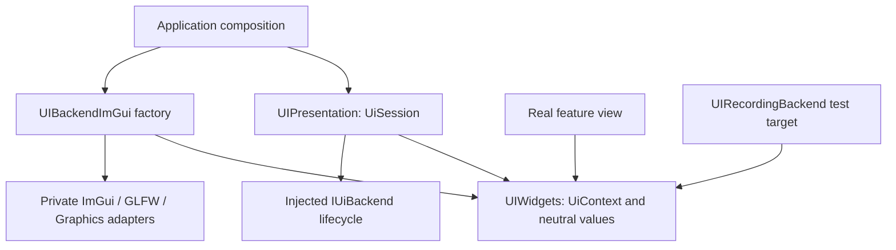

# ED6.2 — Neutral Editor UI API and Private ImGui Backend

- Status: implementation in progress; ED6.2 is not accepted (G1–G2 and G4 evidence recorded; G3 and G5–G8 remain under audit)
- Date: 2026-11-10
- Parent: [ED6](ED6.md); acceptance ledger: [Editor TODO](../TODO.md)
- Prerequisites: [ED6.0 baseline](../.review/ED6.0.md); preserve accepted ED6.1 lifecycle semantics
- Design-risk review: [ED6.2](../.review/ED6.2.md)
- Execution scope: [spec](../../../.spec/specs/editor-ui-ed6-2.md)
- Planning evidence: [journal](../../../.spec/journal/2026-11-10-editor-ui-ed6-2.md)

## 1. Questions this stage must answer

Can a real feature view use Editor-owned UI types and operations while:

1. Compiling without ImGui headers, include paths, or symbol calls?
2. Running on both ImGui and recording backends with consistent interaction semantics?
3. Initializing, rolling back, and shutting down presentation independently of
   RuntimeLib, EditorLib, and SceneEditor?
4. Associating control identity and semantic declarations with resolved layout
   as a foundation for later agent observation?

ED6.2 delivers a compilable, testable boundary and a connected migration path.
It does not migrate every feature view or prove that another production GUI
library can already replace ImGui. Target names, paths, and API sketches below
are proposed contracts, not existing APIs.

## 2. Observed constraints and reuse decisions

The baseline is HEAD `90f6597668c74774fcbdd3e11ed57cd0cf9545d3` plus the dirty
working tree, including Settings, Log, and ED6.1 implementation. Record that
state again before source implementation.

| Existing operation / evidence | ED6.2 placement and reason |
|---|---|
| `EditorPanelContent::Update/DrawContent/OnCloseRequested/PollCloseRequest` | Preserve updates, hidden upkeep, and close decisions; pass UiContext explicitly to drawing, with compatibility in the old window wrapper |
| `EditorUI::InitializeViewer` and five standalone host families | Preserve callers while extracting presentation lifetime; quarantine old callbacks rather than migrating every view at once |
| `InitializePresentation` also reads Editor configuration and creates a loading tree | Keep configuration and tool construction in application/legacy composition; the new presentation object accepts configuration values and an injected backend |
| WSI/GL/Vulkan adapters and Graphics presentation bridge | Move implementation into the private backend; preserve context affinity, callback ordering, and RHI execution |
| `EditorUiFramePacket` contains ImVec2, ImDrawData conversion, and glow callbacks | Keep this rendering conversion inside the backend; it is neither a public UI description nor agent semantics |
| LogColor, ImFont/ImTextureID, and raw flags in renderer/component contracts | Use neutral Editor values in new interfaces; retain old forms only in explicitly tracked compatibility code |
| `RenderTargetView` contains native image fields and expires on resize | Resolve it only in Graphics/backend bindings; feature UI receives a lifetime-bound UiImageRef |
| Settings scalar/enum helpers | Use them as the real feature subview pilot; preserve Reflection metadata, draft results, and registry/provider/save behavior |

The first extraction separates UI operations, presentation lifetime, and backend
state. It does not rewrite every tool's base class, layout algorithms, domain
models, GPU retirement, or command registry.

## 3. Targets and dependency boundaries



| Target | Sources and responsibility | Allowed dependencies | Prohibited dependencies or leakage |
|---|---|---|---|
| `UIWidgets` | Public values, IDs, UiContext, scopes/results, control and canvas contracts | C++ standard library; justify any existing independent foundation library individually | ImGui, GLFW, Vulkan, RuntimeLib, EditorLib, domain services; avoid the broad Core umbrella |
| `UIPresentation` | UiSession, frame state machine, content scheduling, statistics, backend injection | UIWidgets | Concrete features, SceneEditor, global RuntimeContext, concrete ImGui headers/renderers |
| `UIBackendImGui` | Context/fonts, widget mapping, input/WSI, GL/Vulkan/RHI adapters, internal draw packets and image bindings | UIWidgets and audited narrow Graphics/platform/ImageIO/Log dependencies; KP::ImGui privately | RuntimeLib, EditorLib, SceneEditor, feature views |
| `UIRecordingBackend` | Operation records, scripted test input, semantic observation fixtures | UIWidgets; test executables own their test-library dependency | ImGui, native windows/GPU, RuntimeLib, EditorLib |
| Legacy `EditorUILib` / compatibility | Old entry points, configuration/tool trees and unmigrated callbacks | New presentation/backend plus temporarily retained old dependencies | Becoming a dependency of any new neutral/backend target |

`UIBackendImGui` may link the toolkit privately. A static library's final
consumer may still require ImGui binaries through normal link-only propagation.
That is different from leaking public compile requirements. Inspect feature
compiler arguments, header closure, exported interfaces, and actual
recording-only links.

Use a dedicated public include root, for example `ui/api/editor_ui/`. The
backend factory exports only a toolkit-free creation entry; native implementation
headers remain private. A consumer must not receive the entire old Editor or
third_party include tree merely to use a control. List sources explicitly.
Do not compile the same implementation into both the new target and aggregate.

### 3.1 Distinguish the backend dimensions

- **GUI backend:** implements neutral controls; ImGui is the production backend here.
- **Platform/graphics adapters:** window/input integration and Vulkan/OpenGL
  submission of ImGui output.
- **Recording backend:** tests requests/results. It is not another production GUI
  and does not prove pixel layout, IME, or GPU lifetime correctness.

## 4. Neutral API v1

### 4.1 Public value types

| Type group | Required semantics |
|---|---|
| UiSessionId / UiNodeId | Unique within a session; derive identity from scope and stable domain keys, not addresses, display labels, or mutable row indexes |
| UiColor / UiVec2 / UiRect | Editor-owned representation; sRGB RGB with straight alpha; rectangles in client logical units |
| UiViewportInfo | Logical extent, framebuffer scale, origin/conversion metadata, and zero-size behavior |
| UiFontRole / UiThemeRole | Named roles such as Body/Code and a bounded token set; no ImFont pointers or copied ImGui enum values |
| UiImageRef | Image reference constrained by session/frame generation; never a native handle or cast ImTextureID |
| UiValue / UiEditResult | Exact bool, i64, u64, double and UTF-8 string values; distinguish changed, committed, and cancelled |
| UiActionId / UiItemState | Supported interaction kinds, enabled/disabled reason, selected/focused state |

IDs must support duplicate visible labels, multiple workspaces, and dynamic
lists. Detect duplicate IDs/collisions in diagnostic builds; changing a label
must not change identity. Borrow string_view/span arguments only until the call
returns; records copy what they retain. No public ImGui flags, contexts, draw
lists, callback userdata, or disguised native `void*` escape hatches.

Feature call sites may use stable string IDs. UIWidgets hashes these to the
backend's numeric node IDs and detects same-frame duplicates/collisions. The
hash is derived from the ID string, never the display label. A public generic
Control submission remains validated; control-specific input/result contracts
live in the standard-control validation owner, outside UiContext's common frame
and dispatch rules.

### 4.2 Controls and containers

| Required v1 operation | Constraint / first consumer |
|---|---|
| Window, Child/scroll region, Row/Column, bounded table/form layout | Explicit scopes; minimal app and Settings fields; full workspace docking remains ED6.3 |
| Text, Button, Checkbox, Selectable, Combo/enum | Separate ID, label and state; disabled controls cannot activate |
| Signed/unsigned/floating input and UTF-8 text input | Preserve exact numeric type, range and step; backend owns edit buffers/IME state without retaining domain-object pointers |
| Disabled group, tooltip, focus request, separator/spacing | Explicit capability, description and scope; feature code cannot depend on implicit last-ImGui-item state |
| Image, limited canvas, and neutral 2D Plot operations | Prove resource/coordinate contracts. The user's 2026-11-11 follow-up authorizes a focused Plot API for the current Audio and Signal Lab consumers; specialized waveform/radial views and gizmos remain feature compositions |
| Named menu actions/results and narrow clipboard/scroll services | Return intents or use narrow services; do not give every control OS/Engine/global-context access |

The API does not copy every ImGui operation or anticipate all future GUI
capabilities. Track needs outside v1 in a capability/extension list. Unsupported
operations produce diagnostics, not access to a toolkit pointer. Domain
algorithms and custom-control state remain feature-owned.

### 4.3 API shape sketches

These sketches express data flow. Freeze exact declarations in ED6.2.0.

```cpp
class IUiBackend; // Neutral widget/frame/shutdown contract; no toolkit types
class UiContext;  // Typed feature-facing facade; owns no domain objects

class UiSession
{
public:
    explicit UiSession(std::unique_ptr<IUiBackend> backend);
    UiInitResult Initialize(const UiSessionConfig& config);
    UiFrameScope BeginFrame(const UiFrameInfo& frame);
    UiContext& Context();
    UiFrameResult EndFrame();
    void BeginClosing();
    void Shutdown();
};
```

UiFrameScope is a session frame token that aborts/cleans up on exceptional exit.
Explicit EndFrame disarms it, preventing duplicate submission. UiContext
dispatches typed operations to IUiBackend and optionally correlates semantic
declarations with resolved observations. It does not build a general UI
command/draw IR for later replay.

IUiBackend operations follow the v1 list using framework-owned descriptors and
results. Existing ImGui renderer/WSI interfaces remain implementation details.
The factory captures injected native services; the session drives Initialize.
The factory and session must not each initialize the same resources.

Feature-side example:

```cpp
void DrawPreferences(UiContext& ui, PreferenceDraft& draft)
{
    auto window = ui.Window({.id = kPreferences, .label = "Preferences"});
    if (!window.ContentVisible())
        return;

    const auto edit = ui.Checkbox(
        {.id = "preferences.enabled", .label = "Enabled"}, draft.enabled);
    if (edit.changed)
        draft.enabled = edit.value;

    if (ui.Button({.id = "preferences.apply", .label = "Apply"}).activated)
        draft.RequestApply();
}
```

Checkbox, Selectable, Combo, NumericInput and TextInput also expose typed
results, so a bool/integer/string field does not require feature-side variant
unpacking. Standard controls use per-type input/result validation before and
after backend dispatch. The authorized 2D Plot extension composes axes, line/bar/
point series and pointer values over Canvas; it does not expand the scalar
UiValue protocol. Complex waveform/radial views and gizmos remain capability
compositions, and there is no generic plugin registry.

UiContext knows nothing about PreferenceDraft, SettingsRegistry, or a domain
command handler. The feature still submits requests through existing revision
and provider rules and waits for actual completion. This is not an agent action
interface and does not serialize arbitrary C++ callbacks.

### 4.4 Scope and input-result contracts

- Use move-only guards for window, child, table and style scopes. The backend
  implements their correct pairing rules. A collapsed/false-Begin window still
  closes its scope correctly while skipping content.
- A title-bar close emits intent. ED6.1 Accept/Defer/Cancel/PollCloseRequest
  determines visibility; the toolkit cannot first latch the window closed.
- UiContext belongs to a UiSession and draws only on that session's UI/render
  lane during an active frame. Diagnose calls outside a frame, cross-session
  scopes, and unbalanced scopes.
- The backend handles navigation, focus and text composition. Public contracts
  return frame results rather than exposing GetIO(). Existing application input
  dispatch respects capture results and processes each event once.
- Preserve i64/u64 precision instead of converting every number to double.
  Cover values above 2^53, limits, overflow, NaN/Inf and invalid ranges. Rebuilding
  a control each frame must not lose its text cursor or uncommitted composition.

## 5. Minimum foundation for later AI Native work

This stage introduces C++ contracts and internal records for observation. It
does not define a JSON wire schema, agent endpoint, natural-language interpreter,
remote action injection, or editable retained UI document.

### 5.1 Separate declarations from resolved observations

| Feature declaration | Backend/frame observation |
|---|---|
| Stable ID, semantic parent, role, label, optional description/units | Actual full/visible bounds, clipping and coordinate metadata |
| Displayed value, enabled state/reason, selection, supported action kinds | Focus/hover/active state, candidate edits, close/activate frame events |
| Semantic containers, stable list-row keys and total count | Submitted/visible range; unmeasured items report unavailable |

A UI-core optional observer correlates both sides by UiSessionId, frame
generation and UiNodeId, then publishes an immutable internal record when the
frame completes. This is an observation projection. Domain state and drafts
retain their existing authoritative owners.

- Every interactive control has an ID, role and label. Features supply business
  meaning and disabled reasons; do not infer them from glyphs, triangles, memory
  addresses or debug symbols.
- Label geometry as actual-backend, test-fixture or unavailable. The recording
  backend does not pretend to be a layout engine. Hidden/clipped nodes must not
  receive fabricated clickable bounds.
- Explicitly convert client logical units to framebuffer pixels. A layout frame
  ID and GPU presentation/capture status are separate facts. Without correlation
  evidence, do not claim a record describes the exact frame visible to the user.
  A later capture protocol can build on these fields.
- When observation is disabled, avoid building string trees/JSON. When enabled,
  reuse capacity, bound record size, and report truncation. Record list counts
  and submitted ranges rather than walking every log/Actor for export.
- Represent a canvas as a stable semantic node with optional summary/actions,
  not one node per line segment or pixel. Features supply waveform/scene meaning;
  images retain the visual detail.
- Records include frame-completeness status. A failed frame does not replace the
  last valid record. Records cannot retain dangling widget parameters,
  callbacks or GPU-binding pointers.

### 5.2 Recording-backend responsibilities

Record neutral operations, scopes, metadata and results. Supply deterministic
in-process test input addressed by stable control ID. Reject disabled actions,
invalid types, unknown IDs and expired session/frame input; consume each event
once.

This is a test driver with explicitly simulated geometry. It does not create a
production agent command registry. Test events go through the same feature
edit/result path that later agent integration should preserve.

**AI-adjacent acceptance:** the same real feature subview on recording and
ImGui backends correlates ID, role, label, value, disabled reason and action
result. At least one production-frame internal observation includes actual
bounds that can be manually checked against an image of that view. External
serialization and automated interaction are separate designs.


## 6. UiSession, presentation, resources and threading

### 6.1 Ownership

| State/resource | Responsible owner |
|---|---|
| UiSession, UiContext, frame IDs/statistics and optional observations | UIPresentation session; application/host owns the session |
| ImGui context, font atlas, toolkit input/edit buffers | Injected ImGui backend; EditorUI must not create a second copy |
| Existing WSI/GL/Vulkan/RHI renderers and draw conversion | ImGui backend, retaining existing thread/retirement rules |
| Native window and Graphics services | Existing application/Runtime/Graphics owners; backend borrows and shuts down first |
| Tool models, domain requests, layout persistence and loading tree | Feature or legacy SceneEditor composition, outside UiSession |
| Physical textures/descriptors/buffers and safe retirement | Existing Graphics/backend owners; preserve safety for submitted work |

UIWidgets/UIPresentation APIs do not require WindowSystem, RenderSystem, Engine
or RuntimeContext. Application composition supplies the existing window and
narrow Graphics bridge at the backend factory boundary. Native services stay
backend-side. The session owns a neutral IUiBackend; a recording backend works
without native services.

### 6.2 Initialization and frame order

The neutral state machine is
`Uninitialized -> Initializing -> Ready -> InFrame -> Ready -> Closing -> Closed`.
Failed initialization returns to a safely destructible state. Preserve the
current order: context/theme/fonts, renderer initialization, then WSI.
Clean up steps that were attempted but failed partially. Release WSI, renderer,
then context in reverse order, at most once each.

The application retains its frame schedule:

1. Update feature/domain models, including hidden upkeep; do not start another
   game/render loop implicitly.
2. Run backend NewFrame/input preparation and activate the UiContext frame.
3. Draw neutral views and, where required, explicitly marked legacy callbacks
   in that same frame.
4. Finish scopes/draw data/observations, submit presentation and return results
   and segmented CPU timings.

The content driver measures tool-update time. Session/backend timings describe
their actual scopes; they cannot infer domain-update or GPU time from widget
submission duration.

Application composition continues to own event polling. The session must not
add a second GLFW poll. Audit WSI callback installation, predecessor chaining
and removal so neutral/legacy paths cannot process input twice.

BeginClosing rejects new work and releases content references while retaining
closing presentation. Final shutdown runs on the render lane before borrowed
window/Graphics services disappear. Observation or error handling cannot
silently extend those services' lifetime.

### 6.3 Images and ED5 effects

- UI receives only UiImageRef and neutral size/UV/color values. A binding adapter
  resolves the existing image source during a valid frame. Tokens carry
  session/frame generation and must be resolved again in subsequent frames.
- RenderTargetView native_image/native_image_view never enter feature UI.
  Reject old tokens after resize/release. Token expiration does not establish
  that GPU work has completed.
- Preserve existing descriptor/binding caches and WaitIdle/retirement owners.
  Extracting targets cannot transfer borrowed texture destruction to a control
  or UiSession.
- Preserve sRGB, image origin/UV, framebuffer scale and shader-publication
  definitions; introduce no duplicate color conversion. Toolkit glow callbacks
  remain backend-internal.
- A SceneEditor/application resource adapter supplies existing effect assets.
  The new presentation object does not inspect the prepared Render catalog.
  Preserve existing basic presentation/closing when scene assets are absent.
  Do not create a scene implicitly, change ED5 defaults, or claim that this
  extraction fixes ED5's known color differences.

## 7. ED6.1 and legacy-host migration

### 7.1 Content bridge

Preserve ED6.1 Update and close decisions. Converge the neutral drawing entry
on `DrawContent(UiContext&)`. EditorWindowComponent remains a legacy adapter
that may internally forward the new entry to old RenderContent() overrides.
Generic hosts call the context-taking entry consistently.

Never draw through both entries or expose a mutable global current context to
features. Retain tests for hidden updates, docked/floating hosting, deferred
close and cancellation.

### 7.2 Two content paths

- **Neutral:** receives UiContext and cannot include/cast out ImGui. The real
  pilot and new consumers use this path.
- **Legacy:** existing std::function<void()> callbacks and old components draw
  inside the same active backend frame. This belongs to the old
  aggregate/compatibility target, not the neutral interface. New consumers
  cannot use it as an API bypass. These views remain explicitly toolkit-bound.

Any narrow frame bridge needed by legacy drawing stays backend/legacy-private;
it cannot export arbitrary native context access. New UI targets never link
back to compatibility. The migration inventory records consumer, file,
remaining toolkit calls, missing capability and follow-up owner; ED6.5 clears it.

| Existing caller | ED6.2 change | Temporarily retained |
|---|---|---|
| SceneEditor EditorUI | Delegate context/fonts/frame lifetime to UiSession; keep configuration/loading construction explicit in composition | Panel factories, Actor/Asset models and workspace policy |
| AudioPlayerMode | Delegate InitializeViewer presentation; retain one context/input chain | Unmigrated audio, Log and transport content |
| TtsEditorMode | Same delegation; TTS retains configuration ownership | TTS workspace/audio controls |
| SignalLabMode | Same delegation, preserving hidden-update semantics | Waveform/spectrum and Log toolkit drawing |
| TerrainEditor | Same delegation and existing image-source binding | Current docking/Terrain UI; no incidental ED6.3 redesign |
| Live2D viewer | Same delegation; reuse its existing window/image source | Custom Live2D interaction and Log content |

These hosts may temporarily retain explicit old aggregate/ImGui compile
dependencies as inventoried migration debt. In ED6.2, the new neutral feature
target and minimal consumer must be toolkit-free. Full feature/workspace
cleanup is ED6.5/ED6.7 acceptance.

### 7.3 Real feature pilot

Extract and connect `SettingsPropertyFieldsView`, a proposed feature subview
replacing the current Settings scalar/enum helpers. It accepts existing
SettingPropertyDefinition/ReflectionValue/draft values and returns field edits
through neutral controls. Existing Settings models still process those edits.

Its separate target links only UIWidgets and necessary neutral
Settings/Reflection types, not RuntimeLib, EditorLib, EditorUILib or ImGui.
Do not inject registry/store access into UiContext.

The production Settings right-hand page must actually call the subview; an
unconnected test demo does not satisfy acceptance. Cover bool, i64/u64/double,
enum, unsupported/read-only states, ranges, disabled reasons and stable IDs.

This is a real feature **subview** pilot, not migration of the complete Settings
window, menu or model ownership. ED6.4 remains open.

## 8. Ordered implementation steps and exit conditions

| Step | Independently reviewable change | Exit condition |
|---|---|---|
| ED6.2.0 Contract freeze | Refresh baseline/caller differences; freeze v1 types, scopes/results, input/image lifetimes, semantic metadata and target graph | No raw toolkit escape hatch; every API has a current consumer/test rationale; execution spec precedes source work |
| ED6.2.1 Neutral core and recording | UIWidgets, UiContext, scope guards, basic controls, optional observer and recording/scripted input | Pure C++ consumer and recording tests have no ImGui/native/Runtime link; precision, identity, scopes and retained-data lifetime pass |
| ED6.2.2 ImGui adapter | Implement v1 mapping; relocate theme/fonts, WSI, GL/Vulkan/RHI conversion and image/effect binding | Compile old implementation exactly once; no vendor types in public API; independent smoke presents without accidental input/pixel/GPU ownership changes |
| ED6.2.3 Session lifecycle | UIPresentation, rollback, frame/capture state, statistics and explicit dependencies; Scene/legacy facade delegation | Consistent lifecycle across recording/ImGui; failed init, repeated close, resize, zero-size and missing-resource paths pass |
| ED6.2.4 Real pilot | Connect SettingsPropertyFieldsView in production Settings and remove replaced helpers | Independent toolkit-free compile/link and recording tests pass; production frames expose matching identity/semantics and actual bounds |
| ED6.2.5 Host delegation | Delegate five InitializeViewer host families to UiSession while preserving listed legacy callbacks | One context/input/frame/submission path per host; presentation creates no implicit Scene Editor tool tree |
| ED6.2.6 Acceptance and handoff | Audit public headers/targets; failure injection, host matrix, captures, matched timing and legacy inventory | Every required gate has passing evidence or is explicitly unaccepted; later stages are not falsely completed |

Execute sequentially; do not run concurrent CMake/MSBuild builds. Each step
remains buildable with a visible validation path. Explain a real consumer and
contract change before extending v1; temporary ImGui parameters are not an
acceptable shortcut.

Separate environment errors from source failures. Roll back only the current
step's changes while preserving unrelated user work; do not use destructive
Git reset/clean.

## 9. Acceptance matrix

Names/commands below are proposed targets, not commands already executed.
Implementation changes public interfaces and CMake boundaries, so apply
[Level 4 validation](../../validation_matrix.md), with targeted inner-loop tests.

| Gate | Required evidence | Failure condition |
|---|---|---|
| G1 Compile isolation | UiApiCompileTest and real Settings-fields target header closure/compiler commands | Public toolkit headers/types/flags; dependence on old aggregate or vendor include paths |
| G2 Independent linking | UiRecordingContractTest uses only neutral targets; EditorUiSmoke uses UI/backend plus narrow Window/Graphics dependencies | Recording links ImGui/native code; minimal presentation links RuntimeLib/EditorLib/SceneEditor/feature tools |
| G3 API behavior | Scripted tests for stable IDs, types, disabled state, changed/committed/cancelled, scopes and retained callback/value lifetime | Duplicate/invalid events, integer precision loss, dangling references or hidden-control interaction |
| G4 AI-adjacent observation | C++ records contain hierarchy/role/label/state/action and geometry provenance, compared across backends | Address/label-derived identity, fabricated geometry, missing truncation or events uncorrelated with controls |
| G5 Lifecycle | Fail context/font/renderer/WSI steps; callback exceptions; repeated shutdown; wrong thread; ED6.1 regression | Leaks, duplicate cleanup, incomplete frames, blocked close or premature service teardown |
| G6 Graphics/images | Debug Vulkan validation and OpenGL; resize/minimize/restore, stale image tokens, font/theme rebuild, ED5 on/off | Validation errors, new color/UV regressions, expired bindings or early submitted-resource destruction |
| G7 Hosts | SceneEditor plus five enabled standalone host families across backends; optional-disabled builds | Duplicate contexts/input/submission, changed host settings/layout, implicit scene-tool construction |
| G8 Final boundary/performance | Full build; complete tests for the affected dependency/consumer closure; actual dependency audit, explicit legacy allowlist, matched RelWithDebInfo CPU samples | New dependency cycles, API leakage, unexplained sustained overhead or unrecorded migration debt |

For G1, inspect compile interfaces and add poison headers containing `#error`
for imgui.h, imgui_internal.h and relevant backend headers **only to neutral
consumers**. This catches PCH/global-include contamination. Do not poison the
backend's legitimate vendor dependency. Text search and successful static
archive creation alone are insufficient; inspect actual public types/compiler
arguments.

For G4, recording geometry is explicitly fixture data. Only the production
adapter reports actual frame bounds. Test observation off/on separately to
distinguish core overhead from recording cost.

Suggested commands, to run only after creating the targets:

```powershell
cmake -S . -B build -G "Visual Studio 17 2022"
cmake --build build --config Debug --target UiApiCompileTest UiRecordingContractTest UiPresentationLifecycleTest SettingsPropertyFieldsTest EditorUiSmoke KimPeanutEngine -- /m:1
ctest --test-dir build -C Debug -N -R "UiApi|UiRecording|UiPresentation|SettingsPropertyFields|EditorPanelContent|EditorUI"
ctest --test-dir build -C Debug -R "UiApi|UiRecording|UiPresentation|SettingsPropertyFields|EditorPanelContent|EditorUI" --output-on-failure
cmake --build build --config Debug -- /m:1
```

The CTest preview is a required scope check: discovery may expand one test
executable into many CTest entries. Run the complete repository suite only when
the user or repository task contract explicitly requires full CTest, or when
the change is too broad to define a defensible affected-test closure. Record
the previewed count and why the selected tests cover this stage; a full build
does not imply a full repository test run.

Verify that CTest actually discovers and executes tests. ED6.0/ED6.1 encountered
missing registration. Record the cause and run the corresponding built
GoogleTest executable directly where necessary; "No tests were found" is not
passing evidence.

The ImGui scope checker applies to backend implementation. Manually check its
known counted-Pop and BeginPopupModal/EndPopup false positives.

### 9.1 Visible runtime and performance evidence

- The independent smoke creates its window through existing Window/Graphics
  services, without RuntimeLib. It covers input, resize, failure and closing.
  Full-engine integration uses Runtime commands and checked-in fixtures;
  do not pull Runtime into the smoke just to obtain screenshots.
- Launch visual applications only through the approved external execution path.
  Verify GLFW30 is on Default desktop and check the foreground handle before
  claiming focus. Never launch inside the sandbox's private desktop.
- For engine captures use capture.screenshot and poll, with engine_window for UI.
  Store unique stage/host/API/case captures under
  `save/screenshots/validation/ed6-2-<stage>-<host>-<api>-<case>.png`.
  Preserve other tasks' files. Rendering integration changes also require
  canonical textured Sponza scene_color/base_color evidence.
- ED6.0 recorded roughly 15 seconds of visible instantaneous CPU rows, not
  matched p50/p95 with an independently verified fixture/camera. Collect a
  repeatable matched baseline before source changes; do not relabel old
  screenshots as a controlled comparison.
- Rebuild RelWithDebInfo. Match commit/tree, host, fixture/camera, viewport,
  actual RT mode, validation, residency, log count/filter, visible panels and
  warm-up. Collect CPU update/build/submit p50/p95 over three uncontended
  30-second windows, separately for observation off/on. Run no concurrent
  builds/tests. Report GPU timings only where existing Graphics timing covers
  the relevant work.
- Investigate sustained regressions above repeat-sampling variation and retain
  samples/rationale in the journal. Without defined scopes or matched
  conditions, do not claim performance acceptance. ED5/SET3 remain independent.

## 10. Risks, tradeoffs and reference evidence

| Risk | Constraint |
|---|---|
| A renamed ImGui wrapper still forces feature rewrites for another toolkit | Semantic types/operations, scopes/results/capabilities, no raw flags/context escape; recording-only compile and real pilot |
| An oversized generic API blocks delivery | Freeze v1 around current consumers; track later plot/docking capabilities and owners explicitly |
| AI preparation introduces a second retained UI/domain store | Optional immutable frame observations only; no JSON/agent transport/layout editor |
| Moving rendering code regresses ED5 | Preserve bridge, resource owners, retirement and pixel policy; separate extraction from algorithm fixes |
| Compatibility callbacks become a permanent public bypass | Separate compatibility target/headers, explicit allowlist and cleanup owners; excluded from neutral acceptance |
| Minimal app quietly links Runtime | Audit actual graph/link map; narrow Window/Graphics bootstrap; recording remains native-free |

Read-only repository discovery inspected AccessKit, Dear ImGui Test Engine and
RmlUi, alongside the existing ED6 Sakura module study. The following are source
observations and local decisions, not source imports or new dependencies.

- **AccessKit**, main `dea4384134abe5d7b0734f56a0fdd8b80a16dfdd`:
  [architecture](https://github.com/AccessKit/accesskit/blob/dea4384134abe5d7b0734f56a0fdd8b80a16dfdd/ARCHITECTURE.md)
  and [schema types](https://github.com/AccessKit/accesskit/blob/dea4384134abe5d7b0734f56a0fdd8b80a16dfdd/accesskit/src/lib.rs)
  define NodeId, Role, Node, TreeUpdate and ActionRequest separately from
  platform adapters. Adopt the distinction between identity, roles/state,
  actions and namespaces. Do not introduce Rust/platform accessibility
  adapters here or claim complete accessibility from the proposed observations.
- **Dear ImGui Test Engine**, main `176a41dd07985ccb65287a569047ab93f2c7f5d0`:
  [item information/hooks](https://github.com/ocornut/imgui_test_engine/blob/176a41dd07985ccb65287a569047ab93f2c7f5d0/imgui_test_engine/imgui_te_engine.h)
  record ID, ParentID, full/clipped rectangles, status and timestamps while
  depending on imgui_internal.h/internal hooks. Adopt separate layout,
  clipping and freshness observations. Do not use internal ImGui IDs/hooks
  as a neutral protocol, add the Test Engine dependency, or assume permission
  to reuse its source.
- **RmlUi**, master `bc6ea0ec9968600d0b6e9dc379c5b9ba20f2806d`:
  [RenderInterface](https://github.com/mikke89/RmlUi/blob/bc6ea0ec9968600d0b6e9dc379c5b9ba20f2806d/Include/RmlUi/Core/RenderInterface.h)
  specifies compile/render/release geometry and texture lifetime. Adopt explicit
  ownership/validity contracts. This is graphics-renderer abstraction evidence,
  not proof of GUI-toolkit-independent feature APIs. Do not adopt its
  HTML/CSS/retained framework.

## 11. Documentation and handoff

Each implementation step records operation, candidate/chosen owner, files and
dependency changes, before/after placement evidence, actual commands/results,
failures and unverified paths. Add source-module guides when those modules
actually exist. Update the parent TODO without prematurely accepting ED6.2
or closing ED6.4/ED6.5 because one fields subview migrated.

ED6.2 handoff requires neutral headers/targets, private ImGui implementation,
recording backend/tests, connected Settings fields, an independent smoke,
host delegation, internal observation evidence, the complete remaining-migration
inventory and actual G1-G8 outcomes. This establishes usable identity,
semantics, layout and interaction relationships for later AI Native work
without prematurely choosing an external format.
