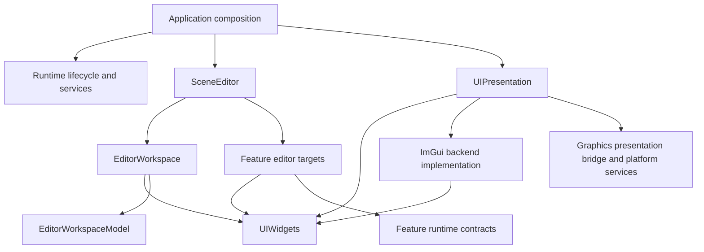

# ED6 — Reusable UI and Editor reconstruction

- Status: ED6.0 baseline frozen; ED6.1 accepted; ED6.2–ED6.7 open
- Parent: [Editor architecture](../PLANS.md), [roadmap](../TODO.md)
- Architecture review: [ED6 review](../.review/ED6.md)
- Baseline freeze: [ED6.0 review](../.review/ED6.0.md)
- Execution scope: [spec](../../../.spec/specs/editor-ui-reconstruction.md)
- Planning evidence: [journal](../../../.spec/journal/2026-11-10-editor-ui-reconstruction.md)

## Outcome and design question

Allow the Scene Editor, Audio Player, TTS, Terrain, Signal Lab, and Live2D tools
to reuse windows, controls, presentation, and optional workspace hosting without
depending on the Scene Editor's tools or configuration. Feature modules own
their editor-facing models, views, and actions. Editor assembles tools into a
workspace; UI supplies the presentation mechanisms.

The concrete question is: how can a new Log or Settings tool be composed into
two applications without editing the generic UI class, adding domain pointers
to its initialization structure, or giving the runtime module a UI dependency?

Source paths and target names below are proposed destinations. ED6.0 freezes
the current source/build baseline, and ED6.1's lifecycle boundary is accepted;
the remaining target split and toolkit-neutral drawing API are not implemented.
The [Editor README](../../../engine/editor/README.md) defines the agreed framework
responsibilities, binding boundary and UI profiling scopes. Reusable UI may
remain within the Editor source directory with independent targets.

## Current design and reusable foundations

`EditorUI` currently combines ImGui context/backend lifetime, preference loading,
startup UI, scene workspace construction, feature models, menu actions, panel
commands, layout persistence, screenshots, and presentation asset selection.
`InitializeViewer` allows other hosts to bypass scene construction, but those
hosts still depend on the same class and target. `EditorUILib` links RuntimeLib,
and RuntimeLib links EditorLib. Moving source directories alone leaves these
dependencies intact.

Preserve and adapt the useful existing operations:

- `IEditorImguiWSI`, `IEditorImguiRenderer`, the copied UI frame packet, and the
  common Graphics presentation bridge already separate native presentation.
- The layout and tool-row models are ImGui-free and own tested placement rules.
- Shared window visibility, stable panel IDs, value-only command queues, and
  hidden-panel pumping already express useful lifetime/interaction contracts.
- Actor and Settings models use snapshots and deferred edits; the reconstruction
  must preserve their domain validation and game/render lane boundaries.
- Audio/TTS share an existing transport strip. Preserve that reuse; its
  playback vocabulary makes it an Audio UI building block.

The working tree already contains a Settings model/view move into
`runtime/settings/editor`, while a concrete window wrapper and shell ownership
remain under Editor. Reconcile that work before implementing ED6; do not undo
it or mistake the directory change for the completed dependency split.

## Target responsibilities and dependencies

| Proposed target / location | Responsibility | Excluded knowledge |
|---|---|---|
| `UIWidgets`, `engine/editor/ui/` | Reusable window/content hosts, controls, menu values, theme tokens, plain UI colors/rectangles | LogSystem, SettingsRegistry, Actors, scene region names, Engine, RuntimeLib |
| `UIPresentation`, a focused Editor presentation owner | Backend-neutral lifecycle, input and image/effect contracts | ImGui in public interfaces, which tools exist, settings-file paths, scene models, concrete RenderSystem |
| `UIBackendImGui`, Editor backend implementation | ImGui context/fonts/widgets, WSI/render adapters and implementation of general UI/canvas operations | Domain algorithms and feature state; toolkit types must stay internal |
| `EditorWorkspaceModel`, `engine/editor/workspace/` | Headless panel identity, visibility, tab/placement state, parameterized split tree, layout serialization | ImGui, feature types, native GPU objects |
| `EditorWorkspace`, same module | Dock/floating hosts, shared menus, focus, overlays, panel lifecycle, workspace command adapter | Constructing Log/Settings/Actor tools or loading domain data |
| Feature editor targets, beside their domains | Tool models/views, service adaptation, feature actions and error feedback | Physical GPU ownership or direct mutable domain access from UI |
| `SceneEditor`, `engine/editor/scene/` | Scene layout preset, selection/interaction coordination, assembly of feature tools | Native UI backend implementation or general widget policy |
| Application integration | Select host, wire services, create optional UI and workspace | Domain algorithms |

Editor provides the general UI API consumed by feature views, SceneEditor and
workspace code. Public component/drawing contracts are toolkit-neutral. Direct
ImGui calls, types, flags, includes and draw-list access are confined to the
Editor backend implementation and its implementation-specific tests. Export
no ImGui include paths or public compile dependency from the neutral API; the
backend owns the toolkit dependency privately. Runtime feature targets remain
UI-free, and the headless workspace model remains independently buildable.

The API covers existing consumers' windows, controls, layouts, theme, input,
images and focused custom-canvas operations. It uses framework-owned IDs,
geometry, colors, image references and typed result/action values. A callback
that accepts ImGui types or exposes its current context is not a neutral boundary.
Add custom plot/viewport/gizmo operations from actual usage; keep their domain
state and algorithms with the feature while adapting rendering below the API.
Small UI drawing functions remain valid through this API. ED6 does not require
a heap-allocated object for each control, a serializable UI tree or another GUI
backend.

`UIWidgets` and `UIPresentation` must not link EditorLib or RuntimeLib, directly
or transitively. SceneEditor may depend on narrow runtime services; the final
RuntimeLib target must not depend on a concrete Editor or feature UI target.
Temporary compatibility targets are permitted during migration, with removal
tracked by stage acceptance. They are not the final architecture.

## Component and hosting contract

Separate content from its container:

1. A content view draws into the current content region. It does not open a
   top-level ImGui window, decide dock geometry, or own a second visibility flag.
2. A generic window host owns Begin/End, chrome, actual bounds, focus and
   open/close requests. It draws content only when the ImGui scope permits it.
3. A workspace host applies docking/placement policy and invokes the same
   content view in a tab, child region, or floating window.
4. A tool/controller updates snapshots and pending results independently of
   whether the content is visible. Hiding a panel cannot strand command results.
5. Closing is an intent. A tool may accept, defer for a draft prompt, or cancel;
   the host commits visibility only after the decision. Forced shutdown follows
   an explicit cancellation/teardown path and cannot block on an invisible prompt.

This removes the current trap where the dock host calls `RenderContent()` and
bypasses a subclass's `Render()` lifecycle. Migrate through compatibility
adapters; do not rewrite every existing component in the first stage. Preserve
useful `EditorWindowComponent` behavior, then retire duplicated host behavior.
Use unique ownership by default; keep shared ownership only for an actual
shared model or artifact with a demonstrated lifetime.

Generic components do not expose `EditorLayoutSlot`. Placement is a relationship
owned by the workspace, attached to content through panel metadata. Workspace
region IDs and split descriptors are values supplied by a preset. Names such
as `WorldOutliner`, panel IDs, default ratios, and placeability belong to the
SceneEditor preset. Initially preserve the current fixed topology and behavior;
arbitrary dock-tree editing is separate work.

## Feature composition and lifecycle

Use per-workspace explicit registration, extending the existing registration
and tool-row operations rather than adding a general plugin/service framework.
Each contribution has a stable ID, title, default placement/open state, owned
tool/view, and optional menu actions. It declares whether it is dockable or
requires a floating host. Register related panels against a shared model owned
by their feature/workspace session; the generic shell does not grow model fields.

Factories capture the narrow borrowed services their feature needs. They do
not receive a universal writable context, a RenderSystem for every tool, or
backend handles. The existing global extension registry has no observed
production registration and cannot describe identity, menus, or panel lifetime;
replace its usage deliberately after rechecking consumers at implementation.

- Reject duplicate IDs with a diagnostic; do not publish a menu for a failed
  contribution. Build a contribution transactionally and roll back partial work.
- Scope IDs and persisted layouts by workspace. Preserve existing scene panel
  IDs and command names. Two host instances must not share a global registration
  list, layout write destination, or mutable feature model accidentally.
- Keep menu bindings alive only while their target exists. Detach commands and
  callbacks before destroying tools; views die before borrowed models/services.
- Register commands through RuntimeCommand's existing value-only request path;
  workspace changes still execute on the render/UI lane. Preserve bounded
  queues, pending versus terminal outcomes, shutdown completion and rejection.
- Render all floating windows before overlay arbitration. Collect all visible
  floating bounds; exclude their union from splitter drawing and hit testing.
  One optional rectangle cannot cover several contributed windows correctly.

The application initializes presentation on the render lane; loading requires
no scene tools. After scene commit, compose feature sessions and promote the
workspace at the existing barrier. BeginClosing rejects new work and releases
feature views/callbacks while services still exist. Closing progress can then
use the surviving presentation stack. Destroy presentation before its borrowed
window/Graphics services, on the owning render lane.

## Ownership and migration map

| Current operation | Chosen destination / reuse decision |
|---|---|
| Generic controls, window, menu and theme drawing in `editor/ui` | `UIWidgets`; retain only live, useful components, not every compiled legacy wrapper |
| `editor/platform`, frame packets and UI render adaptation | `UIPresentation`; preserve the Graphics bridge and GPU retirement owners |
| `EditorUI::CreateImguiBackends`, frame timings and image presentation | Presentation owner; supply configuration/resources at composition |
| Log viewer in `editor/log` | `runtime/core/log/editor`, separate `LogEditor` target; runtime Log target stays UI-free |
| Settings model/view and Editor-owned concrete wrapper | `runtime/settings/editor`, separate headless model and `SettingsEditor` UI targets; wrapper behavior becomes feature tool intents plus generic hosting |
| Command console in `ui/component` | `runtime/command/editor`, `CommandEditor`; service access and hidden upkeep stay with the console |
| Audio output panel and transport strip in Editor UI paths | `runtime/audio/editor`; a narrow `AudioEditorWidgets` target allows Audio Player and TTS to share value/action-based controls without importing the whole player |
| Asset browser/reference models and views | `runtime/asset/editor`, `AssetEditor`; keep copied catalog/selection contracts, never arbitrary loading from generic UI |
| Actor inspector/outliner and shared Actor model | `runtime/gameplay/editor`, `GameplayEditor`; keep the existing runtime editor bridge UI-free; SceneEditor coordinates viewport/gizmo selection |
| Camera controls, viewport and transform interaction | `editor/scene`; these are scene editing interactions rather than general controls |
| Debug Viewer and GPU Profiler | `runtime/render/editor`, separate `RenderEditor` target. Render supplies render profiles and diagnostic targets. SceneEditor injects frame-loop/UI timings and image presentation. Graphics retains GPU resource lifetime. |
| Loading view and Startup Profiler | Editor startup presentation, fed by Runtime startup snapshots and platform memory samples. |
| Tool row, splitters and layout persistence | Reuse in EditorWorkspaceModel/EditorWorkspace; scene defaults move to SceneEditor |
| `EditorSettings` palette/config reading | Application/feature configuration; plain UI theme colors no longer depend on LogColor or logging entries |
| Actor/Settings scalar and enum control selection | Optional `UIReflection` adapter after auditing both real consumers; shared value/metadata widgets, feature-owned drafts, validation and transactions |

Directory nesting is source organization, not a target dependency: runtime
targets must never add their `editor/` subdirectory's sources to the runtime
library. Give feature UI its own target; do not continue contributing every
feature into EditorUILib. New module guides/subplans are added only when those
modules are actually created during implementation.

Log access should be an explicit snapshot source. A default source can wrap the
existing Logger at composition; the view does not silently select a global
logger when passed null. Preserve snapshot locking and bounded retention.
Optimize snapshot/filter work only if measured; do not combine an ownership
move with a logging algorithm rewrite.

Presentation configuration is passed as values or narrow resource providers.
UI initialization does not read `config/settings.json` or create scene loading
tools implicitly. The common renderer uses a general RGBA type rather than
`LogColor`. Existing bloom shader publication comes through the established
presentation-asset lifetime boundary; remove concrete RenderSystem/catalog
lookup from generic UI without passing borrowed shader pointers across frames
or moving GPU objects into tools. Loading and closing remain functional when
scene presentation assets are unavailable.

## Stages and acceptance

### ED6.0 — Freeze baseline and ownership map

- Reconcile current uncommitted Settings work; record exact source state and
  consumers before each move. Resolve live sources versus `docs/dead_code.md`.
- Inventory target/include dependencies and actual extension registrations;
  capture current scene and standalone layouts, panel commands and saved formats.
- Record Debug correctness baselines and matched RelWithDebInfo UI build/submit
  timings. Existing ED5 and SET3 acceptance gaps remain separate.
- Accept when every live component has a chosen owner, caller and lifetime, and
  each later stage has a buildable migration boundary. No broad source move yet.

### ED6.1 — Separate content from windows and workspace policy

- Introduce the smallest content/host contract justified by Log, Settings and
  their existing dock/floating use. Keep temporary wrappers for existing callers.
- Move scene layout selection off the generic component base. Preserve window
  focus/chrome, close/reopen, stable ImGui IDs, and conditional Begin/End behavior.
- Accept when identical content works under a tab and standalone window; hidden
  upkeep and deferred/cancelled close work in both. Model tests stay ImGui-free.

### ED6.2 — Extract reusable widgets and presentation targets

Detailed contract, AI-adjacent preparation, ordered implementation and gates:
[ED6.2](ED6.2.md). This stage has a separate
[execution scope](../../../.spec/specs/editor-ui-ed6-2.md) and
[design-risk review](../.review/ED6.2.md); source implementation remains unstarted.

- Create UIWidgets/UIPresentation and a private ImGui backend with explicit
  source lists. Provide the general UI API and toolkit-neutral public types;
  feature content receives this API rather than using global ImGui calls.
  Preserve ED6.1's accepted lifecycle while extending its drawing boundary.
  Adapt current
  WSI/render interfaces and neutralize configuration, colors, effects and images.
- Migrate `InitializeViewer` consumers to the presentation API, initially retaining
  each host's existing content callback and layout. Keep SceneEditor behind a
  compatibility facade while later stages remove feature knowledge.
- Accept when a minimal UI application builds and links without RuntimeLib,
  EditorLib, scene tools, or feature editor targets; Vulkan/OpenGL presentation,
  input, resize, rollback and shutdown remain functional. No hidden scene tree.
  A feature-view consumer compiles without ImGui headers/include paths. A small
  recording/mock backend exercises the API independently of ImGui; this is a
  contract test, not a claim that another production GUI backend exists.

### ED6.3 — Establish explicit workspace composition

- Parameterize existing layout resolution with workspace region descriptors;
  keep scene preset IDs and a legacy file adapter. Extract workspace models,
  panel ownership, commands, menu bindings and complete overlay arbitration.
- Add per-instance contributions and consistent update/draw/close lifecycle.
  Persist layouts by workspace, with explicit legacy scene-layout discovery.
- Accept duplicate-registration rollback, absent optional features, two workspace
  instances, all-floater occlusion, menu target lifetime, and pending commands on
  close. A second real consumer, preferably Terrain's existing docked workspace,
  must use the host without scene-specific region enums or factories.

### ED6.4 — Move Log and Settings ownership end to end

- Create LogEditor and SettingsEditor targets beside their domains. Move their
  model/view/action construction and lifecycle out of EditorUI, including the
  Settings-specific wrapper policy. Compose their generic hosts explicitly.
- Reuse the Log viewer in SceneEditor and Signal Lab; retain its other callers.
  Reuse Settings with a second host/harness without extending UI initialization.
- Accept when generic UI/workspace code contains no concrete Log/Settings tool
  type or service pointer; runtime Log/Settings targets build without UI. Verify
  drafts, pending edits, explicit saves, failed saves, and close/reopen behavior.

### ED6.5 — Complete feature migration and SceneEditor composition

- Migrate Console, Asset, Gameplay, Audio and diagnostics in small owner-based
  changes. Preserve feature models and cross-panel state together. Extract only
  actually shared Reflection controls; leave transform/selection policy local.
- Migrate direct ImGui calls to the Editor UI API, including specialized
  canvases, input and image usage. Move toolkit-specific implementations into
  the backend without moving domain algorithms/state. Track remaining legacy
  includes/calls explicitly until the last consumer is migrated.
- SceneEditor owns its layout preset, coordinated selection/gizmo/viewport
  behavior, and feature assembly. Standalone tools select presentation alone or
  presentation plus workspace hosting according to their existing needs.
- Accept when adding/removing one feature changes application composition and
  that feature's target, without changing UIWidgets/UIPresentation/EditorWorkspace.
  Validate all enabled standalone modes and disabled optional-module builds.

### ED6.6 — Remove concrete Editor dependency from Runtime

- Reuse `IApplicationHost` presentation callbacks as the runtime entry point.
  Extend its optional lifecycle with explicit workspace-commit and begin-closing
  notifications needed by the current loading/promotion barrier. These callbacks
  expose no ImGui, workspace, concrete Editor or native GPU types.
- Keep built-in Scene3DHost and core scene ownership under Runtime. Move the
  concrete SceneEditor construction to application integration: inject an
  optional presentation factory/attachment for the selected host instead of
  constructing Editor in Engine. Use the existing host registry/descriptor to
  select attachments outside Engine; do not add mode-name branches or a second
  runtime service locator. Pin the minimal factory/attachment API in this stage's
  implementation spec after auditing exact startup and teardown order.
- Remove `Engine::unique_ptr<editor::Editor>`, direct Editor calls/includes and
  RuntimeLib's EditorLib dependency. Runtime drives the neutral lifecycle; the
  application/host attachment owns the concrete tool session and its UI state.
- Accept when the target graph is acyclic across Runtime and UI/Editor, and a
  runtime consumer links without concrete Editor libraries. Check loading
  failure, close during promotion, teardown progress, host initialization failure
  and command cancellation on both APIs. Preserve the scene3d host ID and CLI.

### ED6.7 — Compatibility removal and final acceptance

- Migrate remaining callers and remove compatibility facades/duplicate factories;
  update module docs and source-placement checks. Audit all public headers and
  actual transitive CMake dependencies against the target table.
- Reject ImGui calls/types/includes in feature views, SceneEditor/workspace
  code and public neutral UI headers. Verify toolkit linkage/include visibility,
  and keep explicit allowlists for backend implementation/tests and third-party
  integrations. Legacy escape hatches cannot satisfy final ED6 acceptance.
- Preserve scene panel IDs and `editor.panel.*` behavior. Read old layout versions
  through a deterministic adapter; preserve the original file before a format
  upgrade. Missing optional panels must not corrupt saved placement or prevent
  startup. Do not silently migrate palette/settings stores as part of ED6.
- Accept only after the final validation matrix below passes or each unrelated
  baseline failure is identified with comparison evidence. Do not mark open ED5
  rendering or SET3 interaction acceptance complete as a result of this refactor.

Order: ED6.0 → ED6.1 → ED6.2 → ED6.3 → ED6.4 → ED6.5 → ED6.6 → ED6.7.
Each stage remains reviewable and buildable. The full target graph is a final
acceptance condition, not a reason for a single large rewrite.

## Validation and evidence

This document is Level 0 planning. Implementation stages changing targets or
shared contracts require Level 4 under the repository validation matrix, with
targeted checks during development. Never run builds concurrently.

- Build boundary checks: minimal UI-only consumer, headless feature model tests,
  runtime-only consumer, and optional modules disabled. Inspect actual link and
  include dependencies, not just renamed targets or successful static archives.
- Behavior: existing layout/tool-row/Actor/Settings/command tests; meaningful
  lifecycle tests for factory rollback, hidden upkeep, callback lifetime,
  duplicate IDs, deferred close, persistence migration, and unavailable services.
- UI correctness: visible Debug Vulkan with validation enabled and OpenGL using
  checked-in startup fixtures. Verify loading, promotion, menu/command open and
  focus, dock/float/reopen, two floating tools, keyboard navigation, compact/wide
  sizes, long/error states, resize and orderly close. Cover SceneEditor and the
  Audio Player, TTS, Terrain, Signal Lab and Live2D hosts that are enabled.
- Capture through Runtime `capture.screenshot` and poll; use `engine_window` for
  UI and preserve canonical textured Sponza scene/base-color evidence where
  rendering integration changes. Files stay under
  `save/screenshots/validation/ed6-*.png` with unique stage/backend names.
- Launch the engine only through the approved external-desktop path. Verify its
  GLFW30 window is on Default; verify foreground handle before claiming focus.
- Performance: rebuilt RelWithDebInfo, matched fixture/camera, viewport, actual
  RT mode, validation state, residency, log count/filter and visible panels;
  record UI build/submit CPU p50/p95 over three uncontended sample windows. A
  sustained regression above measurement noise requires investigation before
  accepting the ownership refactor. No performance claim from Debug timings.

## Reference study and decisions

The discovery pass inspected SakuraEngine, Piccolo, and Walnut repositories.
These are source observations, followed by local design choices:

- **Sakura**, `engine` at `c0fdb2bb30074058cb98df98b8134559d13d67b0`:
  [SkrImGui build](https://github.com/SakuraEngine/SakuraEngine/blob/c0fdb2bb30074058cb98df98b8134559d13d67b0/engine/modules/editor/imgui/build.cs)
  declares a separate ImGui module depending on system/renderer modules; the
  [SkrGui build](https://github.com/SakuraEngine/SakuraEngine/blob/c0fdb2bb30074058cb98df98b8134559d13d67b0/engine/modules/gui/gui/build.cs)
  declares a separate GUI framework and its text/widget dependencies. Adopt
  explicit module dependencies as a checkable boundary. Their build files do
  not prove every tool ownership/lifetime rule; do not infer that. Do not adopt
  the second GUI framework, build system or text stack.
- **Walnut**, `master` at `3b8e414fdecfc6c8b58816106fe8d912bd172e31`:
  [Layer](https://github.com/StudioCherno/Walnut/blob/3b8e414fdecfc6c8b58816106fe8d912bd172e31/Walnut/src/Walnut/Layer.h)
  separates update and UI rendering, while
  [Application](https://github.com/StudioCherno/Walnut/blob/3b8e414fdecfc6c8b58816106fe8d912bd172e31/Walnut/src/Walnut/Application.cpp)
  owns context/frame lifetime, layer invocation and menu composition, and detaches
  layers before backend teardown. Adopt explicit content/lifecycle composition.
  Reject its public Vulkan accessors and direct GLFW/Vulkan application ownership
  for tools; KP already has a Graphics boundary and game/render lanes. Its simple
  loop is not evidence for KP thread safety or GPU retirement.
- **Piccolo**, `main` at `f5053707fed4d3f94d270a436fb0d3a8ae54e3e5`:
  [WindowUI](https://github.com/BoomingTech/Piccolo/blob/f5053707fed4d3f94d270a436fb0d3a8ae54e3e5/engine/source/runtime/function/ui/window_ui.h)
  separates window UI entry points from concrete
  [EditorUI](https://github.com/BoomingTech/Piccolo/blob/f5053707fed4d3f94d270a436fb0d3a8ae54e3e5/engine/source/editor/include/editor_ui.h).
  Adopt the distinction between presentation and scene UI. Its concrete EditorUI
  still declares the scene windows together; that arrangement does not resolve
  KP's multi-host reuse requirement. Reject passing broad shared RenderSystem
  ownership through every generic UI initialization structure.

## Constraints, alternatives and remaining decisions

- Sequence clarified on 2026-11-10: ED6 establishes a general Editor UI API and
  isolates ImGui inside its backend while reconstructing ownership/dependencies.
  A separate design afterward addresses structured agent-readable UI and another
  production GUI backend. A serializable UI schema, agent-driven structural
  editing and replacement GUI backend remain outside ED6 acceptance; the neutral
  API and migration of feature-level ImGui usage are required within ED6.
- Keep Dear ImGui and current window/RHI integration. A Qt migration, custom
  retained widget framework, dynamic plugins, arbitrary dock-tree editing, and
  new undo/serialization systems are outside ED6.
- Feature co-location is the chosen convention; preserve Editor-owned scene
  interaction policy where it has a real cross-feature consumer. Do not relocate
  all code mechanically to whichever subsystem supplies one data type.
- A directory-only move is insufficient; verify target, initialization and
  lifetime boundaries. An interface or service registry without removing concrete
  construction from the generic shell is also insufficient.
- Avoid making every control a heap-allocated virtual component. Use focused
  general UI functions/components and value/action contracts, with toolkit
  rendering internal to the ImGui backend.
- The final neutral host attachment signature, schema version needed for
  workspace-scoped persistence, and measured performance tolerance are stage
  implementation decisions. Their required ownership/compatibility outcomes
  above are fixed; record the evidence before selecting the exact API/version.
- ED5 presentation changes and ongoing Settings work share these files. Capture
  their current baseline before each stage and preserve unresolved acceptance.
